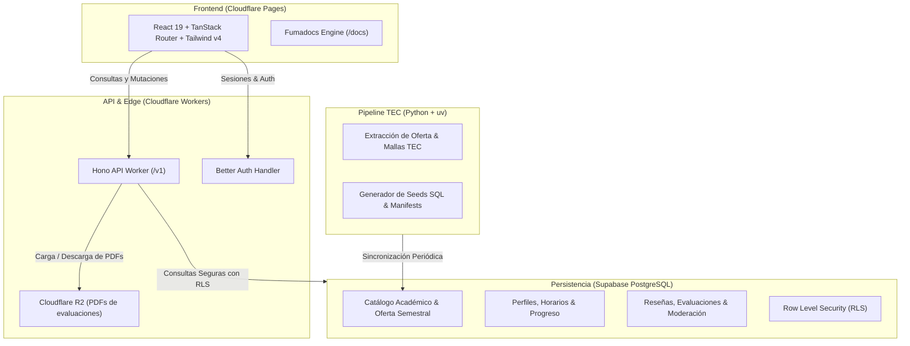

<div align="center">


# Claustrum

**Plataforma académica integral y de código abierto para estudiantes del Instituto Tecnológico de Costa Rica.**

Diseñada para simplificar la planificación de horarios, el seguimiento de la malla curricular, la consulta de profesores y el acceso colaborativo a evaluaciones pasadas mediante una interfaz de alto rendimiento.

[](https://turbo.build/)
[](https://react.dev/)
[](https://www.typescriptlang.org/)
[](https://vite.dev/)
[](https://tailwindcss.com/)
[](https://workers.cloudflare.com/)
[](https://supabase.com/)
[](https://pnpm.io/)

[Características](#características-principales) • [Arquitectura](#arquitectura-del-sistema) • [Estructura](#estructura-del-monorepo) • [Requisitos](#requisitos-previos) • [Inicio rápido](#inicio-rápido) • [Variables de entorno](#variables-de-entorno) • [Scripts](#scripts-disponibles) • [Documentación](#documentación)

</div>

> [!NOTE]
> Claustrum es una iniciativa comunitaria e independiente desarrollada por y para estudiantes. No está respaldada, afiliada ni representa de forma oficial al Instituto Tecnológico de Costa Rica.

---

## Características principales

- **Malla curricular interactiva**: Navegación visual del plan de estudios con trazado dinámico de requisitos, correquisitos, equivalencias y seguimiento de cursos aprobados o en curso.
- **Planificador inteligente de horarios**: Exploración de oferta académica oficial por periodo y campus, detección automática de colisiones horarias y guardado de combinaciones de matrícula.
- **Directorio de profesores y reseñas**: Métricas comunitarias (calidad, dificultad, claridad y asistencia) con filtros por curso, moderación de contenido y prevención anti-spam.
- **Banco de evaluaciones en PDF**: Consulta y carga comunitaria de exámenes y pruebas anteriores mediante almacenamiento seguro en Cloudflare R2, visor integrado y flujo de moderación.
- **Autenticación flexible y robusta**: Gestión de identidad impulsada por Better Auth con soporte para correo institucional, enlaces mágicos (magic links), Google OAuth, doble factor (2FA) y recuperación de contraseñas.
- **Experiencia de usuario refinada**: Construida con componentes accesibles sobre shadcn/ui y Base UI, temas claro/oscuro con detección del sistema y transiciones fluidas.

---

## Arquitectura del sistema

El proyecto opera como un monorepo administrado por Turborepo, integrando servicios serverless de alto rendimiento y una base de datos relacional con seguridad a nivel de filas (RLS).



---

## Estructura del monorepo

```
horarios/
├── apps/
│   ├── web/               # SPA React 19, TanStack Router/Query, Fumadocs y Tailwind v4
│   └── api/               # Cloudflare Worker con Hono, Better Auth y capa de servicios
├── supabase/
│   ├── migrations/        # Migraciones SQL versionadas con esquemas y políticas RLS
│   ├── seeds/             # Seeds deterministas para catálogo y datos iniciales
│   └── tec-data/          # CLI en Python (uv) para extracción y sincronización académica
├── scripts/               # Utilidades TypeScript para aplicación de seeds y generación OG
├── turbo.json             # Configuración de pipeline de Turborepo
└── package.json           # Dependencias raíz del workspace (pnpm)
```

---

## Requisitos previos

Asegúrate de contar con las siguientes herramientas en tu entorno local:

- **Node.js**: `v20.0.0` o superior
- **pnpm**: `v12.0.0` o superior (gestor de paquetes obligatorio)
- **Docker**: Para ejecutar Supabase localmente
- **Python** (Opcional): `3.14+` y [`uv`](https://docs.astral.sh/uv/) únicamente si requieres ejecutar el pipeline de datos en `supabase/tec-data`

---

## Inicio rápido

### 1. Clonar el repositorio e instalar dependencias

```bash
git clone https://github.com/mau671/horarios.git
cd horarios
pnpm install
```

### 2. Configurar variables de entorno

Copia las plantillas correspondientes para el frontend y el worker:

```bash
# Variables del cliente web
cp apps/web/.env.example apps/web/.env.local

# Variables del API worker
cp apps/api/.dev.vars.example apps/api/.dev.vars
```

> [!TIP]
> Para el entorno de desarrollo básico puedes utilizar los valores por defecto de la instancia local de Supabase (`http://127.0.0.1:54321`).

### 3. Iniciar la base de datos local

Inicia los servicios locales de Supabase y aplica las migraciones:

```bash
pnpm run supabase:start
pnpm run supabase:migrate-dev
pnpm run supabase:seed
```

> [!IMPORTANT]
> **Nunca ejecutes comandos destructivos** en la base de datos (como `supabase db reset`). Utiliza siempre `pnpm run supabase:migrate-dev` o `pnpm run supabase:migrate` para aplicar cambios de esquema pendientes sin perder los datos sincronizados.

### 4. Iniciar los servidores de desarrollo

Ejecuta todas las aplicaciones simultáneamente con Turborepo:

```bash
pnpm run dev
```

O si prefieres ejecutar un servicio específico:

```bash
pnpm run dev:web  # Inicia únicamente la aplicación web (http://localhost:3000)
pnpm run dev:api  # Inicia únicamente el API Worker (http://localhost:8787)
```

---

## Variables de entorno

### Frontend (`apps/web/.env.local`)

| Variable                        | Descripción                                                             |
| ------------------------------- | ----------------------------------------------------------------------- |
| `VITE_SUPABASE_URL`             | URL base de Supabase (`http://127.0.0.1:54321` en local).               |
| `VITE_SUPABASE_PUBLISHABLE_KEY` | Clave pública de Supabase para operaciones en el cliente.               |
| `VITE_API_BASE_URL`             | Endpoint base del Cloudflare Worker (`http://localhost:8787` en local). |
| `VITE_TURNSTILE_SITE_KEY`       | Clave pública de Cloudflare Turnstile para protección contra bots.      |

### Backend API (`apps/api/.dev.vars`)

| Variable               | Descripción                                                                         |
| ---------------------- | ----------------------------------------------------------------------------------- |
| `SUPABASE_URL`         | URL de la instancia de Supabase.                                                    |
| `SUPABASE_SECRET_KEY`  | Clave de servicio para consultas administrativas y moderación.                      |
| `DATABASE_URL`         | Cadena de conexión directa de PostgreSQL para Better Auth.                          |
| `BETTER_AUTH_SECRET`   | Secreto criptográfico para firma de tokens de sesión.                               |
| `BETTER_AUTH_URL`      | URL base pública de autenticación (`http://localhost:8787`).                        |
| `TURNSTILE_SECRET_KEY` | Clave privada de validación de tokens de Cloudflare Turnstile.                      |
| `RESEND_API_KEY`       | Clave de Resend para envío de correos transaccionales (magic links y verificación). |
| `CORS_ORIGINS`         | Orígenes permitidos separados por coma (ej. `http://localhost:3000`).               |

---

## Scripts disponibles

Los comandos se ejecutan desde la raíz del proyecto usando `pnpm`:

### Desarrollo y compilación

| Comando            | Descripción                                                                  |
| ------------------ | ---------------------------------------------------------------------------- |
| `pnpm run dev`     | Inicia todos los servicios del monorepo (`web` y `api`) con Turbo.           |
| `pnpm run dev:web` | Inicia el frontend de Vite en `http://localhost:3000`.                       |
| `pnpm run dev:api` | Inicia el servidor local de Wrangler para el API Worker.                     |
| `pnpm run build`   | Compila la documentación con Fumadocs, valida TypeScript y empaqueta la app. |

### Calidad de código y formato

| Comando              | Descripción                                                    |
| -------------------- | -------------------------------------------------------------- |
| `pnpm run lint`      | Ejecuta el análisis estático en todo el monorepo con `oxlint`. |
| `pnpm run lint:fix`  | Aplica correcciones automáticas de linting.                    |
| `pnpm run fmt`       | Aplica formateo de código con `oxfmt`.                         |
| `pnpm run fmt:check` | Verifica que el código cumpla con el estándar de formato.      |

### Base de datos (Supabase)

| Comando                         | Descripción                                                      |
| ------------------------------- | ---------------------------------------------------------------- |
| `pnpm run supabase:start`       | Levanta los contenedores locales de Supabase vía Docker.         |
| `pnpm run supabase:stop`        | Detiene los contenedores locales de Supabase.                    |
| `pnpm run supabase:status`      | Muestra el estado y puertos de los servicios locales.            |
| `pnpm run supabase:migrate-dev` | Aplica las migraciones SQL pendientes al entorno local.          |
| `pnpm run supabase:seed`        | Carga los datos base del catálogo académico y planes de estudio. |
| `pnpm run supabase:setup`       | Configura el entorno local completo (start + migrate + seed).    |

---

## Documentación

El proyecto cuenta con documentación técnica exhaustiva impulsada por **Fumadocs**, accesible directamente en la ruta `/docs` al ejecutar la aplicación o explorando los archivos en `apps/web/content/docs/`:

- [Esquema de base de datos](apps/web/content/docs/database/schema-overview.mdx): Diagrama entidad-relación, dominios y principios de modelado.
- [Migraciones y políticas RLS](apps/web/content/docs/database/migrations-rls.mdx): Mecanismos de seguridad y permisos por rol.
- [Pipeline de extracción TEC](apps/web/content/docs/tec-data/pipeline.mdx): Funcionamiento de `tec-data`, sincronización periódica y manifests de datos.
- [Despliegue y operaciones](apps/web/content/docs/deployment-env.mdx): Flujos de CI/CD en GitHub Actions y publicación en Cloudflare.
